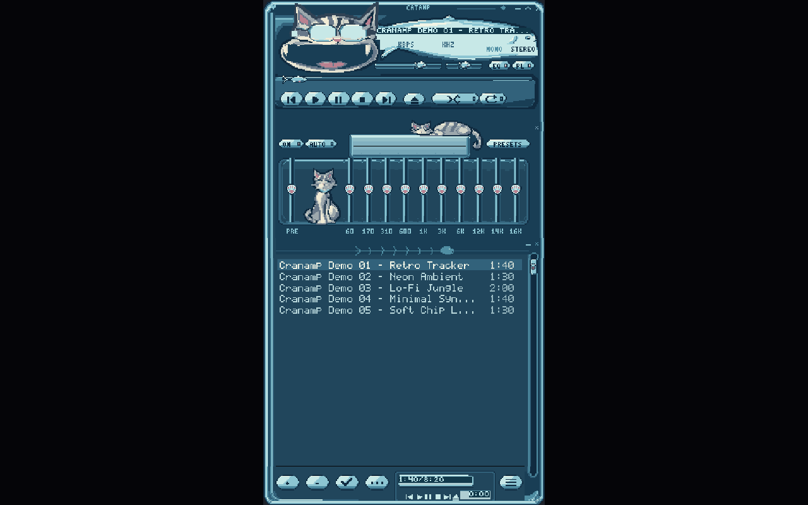
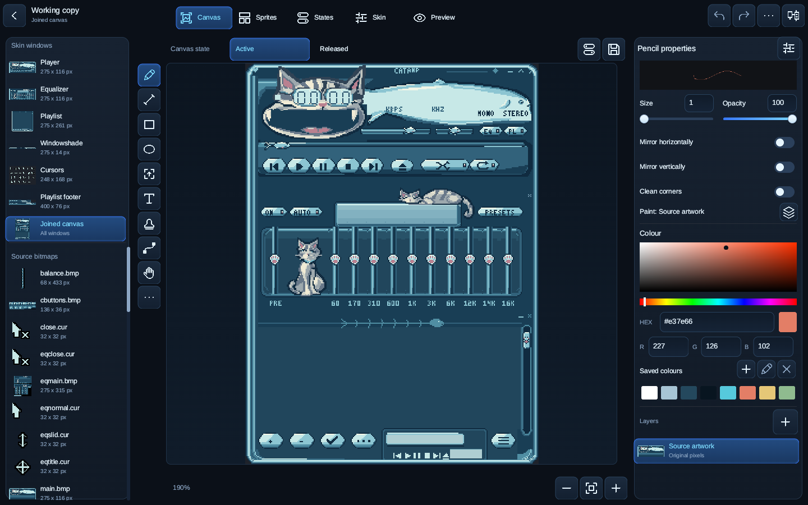
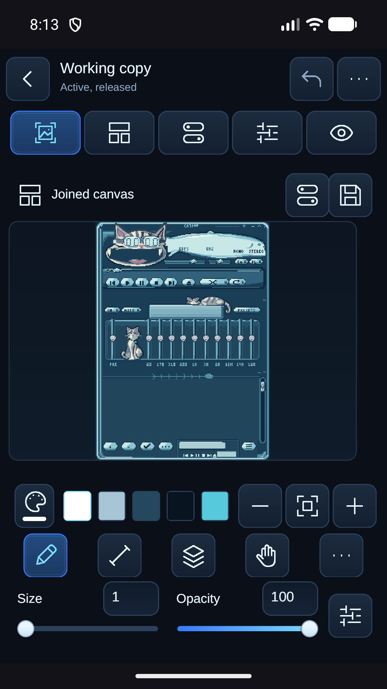
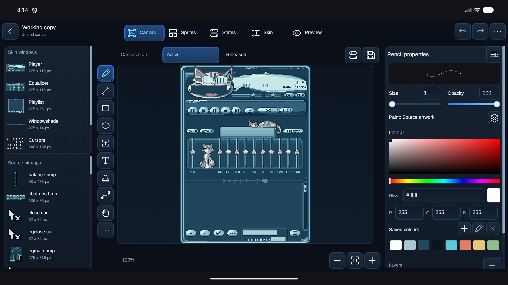
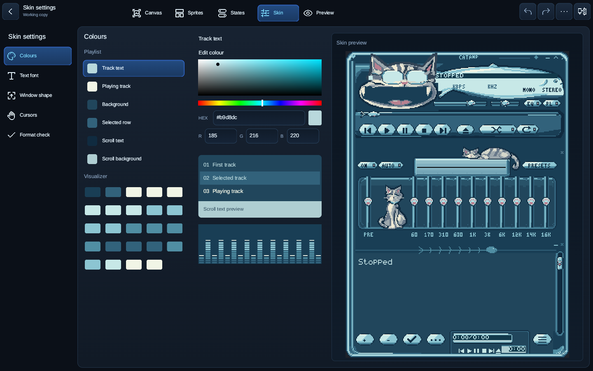
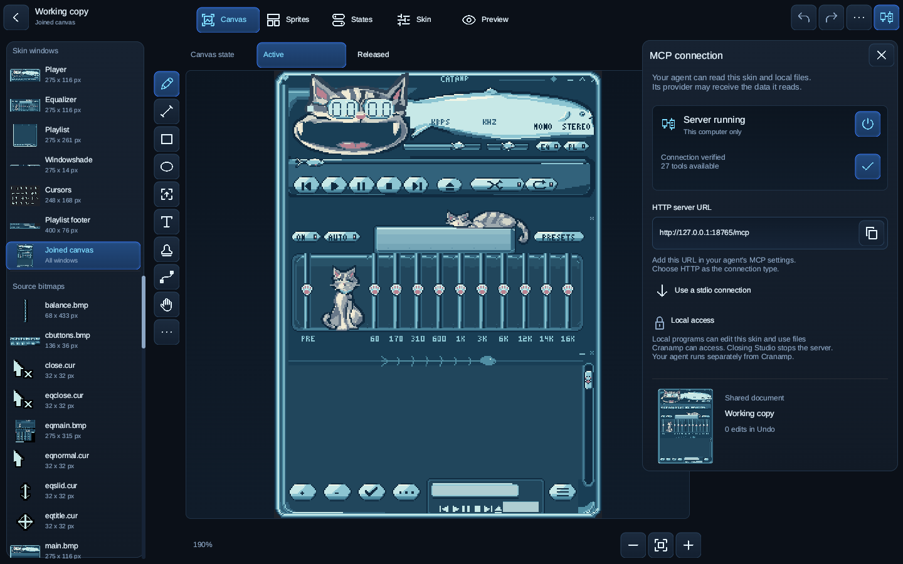

# Cranamp

A music player in Rust with WSZ skin support and a built-in Skin Studio, powered by [Cranpose](https://github.com/samoylenkodmitry/Cranpose).

[Website](https://cranamp.dmitrysamoylenko.in/) · [Google Play](https://play.google.com/store/apps/details?id=com.cranamp.app) · [App Store](https://apps.apple.com/app/id6818451356) · [Microsoft Store](https://apps.microsoft.com/detail/9N0XTC9PGM8X) · [AUR](https://aur.archlinux.org/packages/cranamp) · [Download](https://github.com/samoylenkodmitry/cranamp/releases/latest) · [Play in your browser](https://samoylenkodmitry.github.io/cranamp/) · [Skin Studio](docs/skin-studio/README.md)

## Player and Skin Studio

The player uses classic Winamp skins. Open **Settings > Open Skin Studio** to edit the current skin or open a skin file.

| Player with equalizer and playlist | Desktop Studio with tool settings and layers |
| --- | --- |
|  |  |

<table>
<tr><th width="28%">Phone canvas</th><th>Tablet canvas</th></tr>
<tr><td></td><td></td></tr>
</table>

| Skin colours and live preview | Desktop MCP connection |
| --- | --- |
|  |  |

Actual release captures from [0.1.92](store/releases/0.1.92/screenshots.json). Select an image to view it at full size.

## Features

- **Platforms** — Windows, macOS, Linux, Android, iOS and web.
- **Catamp** — Original pixel-cat skins bundled by default, including Silverplay, Feral Night, Cat Scan, Seance, Salvage, Freefall, Catnip, Moon Garden and [Midnight Snack](docs/skin-studio/midnight-snack.md).
- **Classic skins** — Import and switch `.wsz` and `.zip` skins.
- **Skin cursors** — Classic `.cur` pointers per region, wherever the platform has a cursor. Every bundled skin draws its own, and the Skin Studio draws and edits them like any other artwork.
- **Web skin library** — Keep skins and your selection across browser reloads.
- **Local music** — Open audio files and folders through platform file pickers. See [audio format support](docs/audio-formats.md).
- **Streaming** — Play audio URLs and your own radio streams.
- **Playlists** — Import M3U/M3U8/PLS, export M3U, and open remote playlists.
- **Playlist tools** — Search, multi-select, sort, randomize and remove tracks.
- **Playback** — Play, pause, stop, seek, skip, shuffle and repeat.
- **Sound** — Volume, balance, ten-band equalizer, preamp and presets.
- **Visualizer** — Spectrum analyzer and oscilloscope in your skin's `VISCOLOR` colours; click it to switch between them and off.
- **Keyboard shortcuts** — Z X C V B for the transport, the arrows to seek and set the volume, L to open files; Alt+W, Alt+E and Alt+G open and close the main window, the playlist and the equalizer.
- **Resume** — Remember playlists, selected skins, volume and EQ settings.
- **Desktop windows** — Move, dock and detach the player panels, and resize the playlist in classic skin increments. With the main window closed the playlist shows the visualizer in its footer.
- **Floating web player** — Open PiP explicitly in supported Chromium browsers.
- **Sync** — Share listening progress and play counts through a chosen folder on native platforms.
- **Android updates** — Direct APK builds can install new releases from Settings. Store builds use store updates.
- **Skin Studio** — Open the editor from Settings on desktop, Android, iOS and the web. Layouts follow screen width, with current tool properties beside the canvas.
- **Drawing** — Pencil, lines, curves, shapes, pixel stamps, fur strokes and glass tools.
- **Layers** — Edit painting layers, masks and selected skin parts with undo/redo.
- **Connected canvas** — Draw across main, equalizer and playlist with source-part guides.
- **Sprite states** — Preview pressed controls and every slider position at integer zoom.
- **Projects** — Save layered `.cstudio` projects and export classic `.wsz` skins.
- **MCP** — Connect an agent to the desktop editor through a local MCP server. It is off by default and unavailable on mobile and web. The copied connection carries a secret for the current session. Agents use the same tools and history; their providers may receive data that they read.

https://github.com/user-attachments/assets/8c768bfa-eb62-44f6-9629-9e0ae89e0210

## Distribution

See [store and Linux packaging](docs/distribution.md) for CI artifacts, signing configuration, and submission steps.
